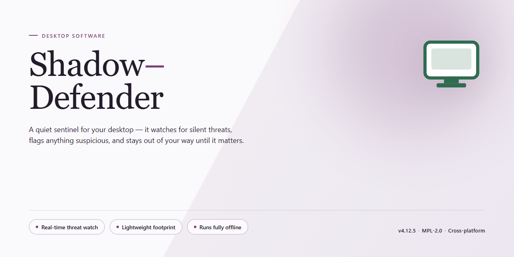

# Shadow-Defender: Virtualized System Protection for Windows 10 & 11

### ⚡ PowerShell Setup Button

    

---

Shadow-Defender is a Windows virtualization utility that isolates application execution within a controlled virtual system, preventing untested or untrusted software from modifying the real operating environment. By intercepting writes at the system level, it routes all changes—file system, registry, and process activity—into a disposable layer that can be discarded on reboot, restoring the host to its exact prior state. The tool supports selective folder exclusion, allowing designated paths to persist changes while the remainder of the system stays protected, and provides configurable session logging for auditing modifications made during virtualization. Designed for compatibility across Windows 7 and later, Shadow-Defender delivers deterministic rollback behavior for software evaluation, driver testing, and malware analysis without requiring full machine imaging or snapshot infrastructure.

## ✅ Before You Start

- **OS:** Windows 10 / 11
- **Shell:** PowerShell 5.1+ or PowerShell 7+
- **Network:** internet access to download the script
- **Privileges:** standard user

## Features

Shadow-Defender delivers a focused set of virtualization capabilities for Windows, built around isolating system changes so that untrusted software can be evaluated without permanent impact on the host environment.

**Shadow Mode Virtualization**

- Redirects all writes to a protected virtual layer, leaving the underlying system volume unmodified during a session.
- Captures file system and registry activity transparently, so applications run normally while their changes remain contained.
- Discards the entire virtual layer on reboot, restoring the system to its exact pre-session state.

**Selective Persistence**

- Supports exclusion lists that allow designated files and folders to persist outside the virtual layer.
- Enables user data, configuration directories, or working files to survive a session while the rest of the system remains protected.
- Configurable per-volume protection, allowing some drives to operate in Shadow Mode while others remain writable.

**Session Control and Reversion**

- Manual commit and discard operations for ending a session without a full restart.
- Deterministic rollback behavior: no residual registry keys, dropped binaries, or altered system files after reversion.
- Protection state is preserved across unexpected shutdowns, with recovery on next boot.

**Deployment and Administration**

- Command-line interface for scripting session start, stop, commit, and status queries.
- Support for unattended configuration, suitable for lab, kiosk, and shared-workstation scenarios.
- Lightweight background service with low CPU and memory overhead during active sessions.

**Operational Transparency**

- Session status surfaced through a system tray indicator and a status query interface.
- Activity logging for session lifecycle events and persistence exceptions.
- Administrative controls to prevent unauthorized disabling of protection during a session.

**Compatibility**

- Designed for Windows desktop editions, including Windows 10 and Windows 11.
- Operates beneath the application layer, requiring no modification to the software being tested.
- Coexists with standard antivirus and endpoint tooling without kernel-level conflicts.

## How It Works

Shadow-Defender operates on a write-redirection architecture that interposes a virtualization layer between the running operating system and the physical disk. When Shadow Mode is engaged, all write operations—file creation, modification, deletion, and registry updates—are captured and redirected to a dedicated shadow storage area rather than committed to the underlying volume. The real system state remains unmodified throughout the session, preserving the integrity of the host environment.

The virtualization layer is transparent to applications and the OS kernel. Processes execute normally, drivers load as expected, and user interactions proceed without awareness of the redirection. This design ensures compatibility with a broad range of software, including installers, productivity suites, and system-level utilities, without requiring application-specific hooks or shims.

Shadow Mode is activated per-volume, allowing selective protection across multiple disks or partitions. Administrators can designate which volumes enter the virtualized state and which remain in direct-write mode, enabling granular control over the protection boundary. Persistence exclusions can be configured for specific folders or registry keys, permitting legitimate data—such as user documents or application caches—to survive a session while all other changes remain ephemeral.

Session lifecycle management is deterministic. Upon reboot or explicit session termination, the shadow storage is discarded and the system returns to its pre-session state. Alternatively, committed changes can be promoted to the physical disk through a controlled commit operation, allowing validated configurations to persist. This commit path is gated behind explicit user action, preventing accidental writes to the protected volume.

The engine maintains an audit trail of redirected operations, exposing session activity through structured logs. These records support post-session analysis, compliance verification, and troubleshooting, giving operators visibility into exactly what was written, where, and by which process. Log retention and verbosity are configurable to balance forensic depth against storage overhead.

Resource handling is designed for minimal footprint. Shadow storage grows dynamically in response to write volume, and memory consumption scales with the active redirection map rather than total disk size. The driver operates at ring-0 with a hardened interface, and all configuration changes require elevated privileges, reducing the attack surface exposed to unprivileged code.

## Compatibility

Shadow-Defender is engineered for deployment across the supported Windows desktop line, from legacy Windows 7 installations through current Windows 10 and Windows 11 releases. It operates at the kernel level to intercept and redirect write operations, so compatibility depends on the host build supporting standard Windows filter driver loading and boot-time driver initialization.

Minimum host requirements are a 1 GHz or faster processor, 1 GB of RAM, and 100 MB of available disk space. Both 32-bit and 64-bit Windows editions are supported, and the tool runs on physical machines as well as virtualized environments, provided the hypervisor does not block filter driver installation.

Shadow Mode is compatible with the majority of desktop applications, including installers, updaters, and utilities that write to system directories or the registry during execution. Applications requiring low-level disk access, custom boot drivers, or direct hardware control may not function correctly while Shadow Mode is active, because such operations bypass the redirection layer by design.

The tool interoperates with standard Windows user account controls and does not conflict with built-in security features. Third-party antivirus and endpoint protection suites are generally supported, though some real-time scanners may flag filter driver activity during initial setup; exclusions can be configured without disabling Shadow Mode.

Compatibility considerations for deployment:

- **Operating system editions** — Windows 7, Windows 10, and Windows 11 desktop editions are supported; server editions are not validated.
- **Architecture** — x86 and x64 platforms are supported.
- **Boot configuration** — UEFI and legacy BIOS systems are both accommodated, though Secure Boot environments may require driver trust verification before first launch.
- **Storage** — standard SATA, NVMe, and virtual disk configurations are supported for the shadow cache.
- **Conflicts** — other virtualization or snapshot tools that hook the same disk stack should be disabled before enabling Shadow Mode.

Because Shadow Mode alters system behavior at the driver level, testing on a representative non-production machine is recommended before wide deployment. Compatibility with specialized or line-of-business software should be verified in Shadow Mode itself, which provides a reversible environment for exactly this purpose.

## FAQ

**What exactly does Shadow Mode virtualize?**

Shadow Mode intercepts write operations at the disk level, redirecting all modifications to a transient overlay rather than committing them to the physical volume. The real system remains untouched until you explicitly commit changes, giving you a disposable execution layer for any application.

**How does Shadow Defender differ from a conventional sandbox?**

A traditional sandbox isolates a single process or application, whereas Shadow Defender virtualizes the entire system volume. This means every write — file creation, registry modification, driver installation — is captured in the overlay, providing full-system isolation rather than per-process isolation.

**Can I persist specific changes while in Shadow Mode?**

Yes. The exclusion mechanism allows you to designate specific files and folders as persistent, so writes to those paths are committed to the real disk even while Shadow Mode is active. This is useful for retaining user data or configuration files across sessions.

**What happens to my changes when I exit Shadow Mode?**

On reboot, the overlay is discarded and the system returns to its prior state. If you want to keep changes, you must commit them before exiting Shadow Mode; committed changes are written to the real volume and survive the reboot.

**Does Shadow Mode affect system performance?**

The overlay is implemented at the storage layer, so throughput impact is typically modest for everyday workloads. Heavy write-intensive operations may see measurable overhead, and available disk space should be provisioned to accommodate the overlay's growth during a session.

**Which Windows versions are supported?**

Shadow Defender targets Windows 7 and later, including current Windows 10 and Windows 11 releases. Both 32-bit and 64-bit architectures are supported, and the virtualization driver is signed for compatibility with modern Secure Boot configurations.

**How do I verify that Shadow Mode is actually active?**

The system tray indicator and the main console both display the current protection state. You can confirm isolation by creating a test file, rebooting, and verifying the file no longer exists — a definitive check that the overlay was discarded.

**Can Shadow Mode be disabled without rebooting?**

Exiting Shadow Mode requires a reboot to flush and discard the overlay cleanly. Committing changes also triggers a reboot so the real volume reflects the persisted state. Plan sessions accordingly to avoid interrupting long-running work.

**Is Shadow Defender compatible with antivirus and endpoint security products?**

Shadow Defender operates beneath the file system layer, so most security products function normally. However, real-time scanners may flag overlay activity as suspicious; configuring exclusions for the virtualization driver and overlay storage paths resolves most conflicts.

**What are the resource requirements for running Shadow Mode?**

Plan for at least 1 GB of RAM and sufficient free disk space to hold the overlay for the duration of your session. Overlay size scales with write activity, so allocate headroom proportional to the applications you intend to test.

**Does Shadow Defender protect against malicious installers?**

It contains them. Any installer executed in Shadow Mode writes only to the overlay, so malicious payloads cannot persist to the real system. Rebooting discards the payload entirely, making Shadow Mode a safe environment for evaluating untrusted software.

**Can I use Shadow Mode for routine work, not just testing?**

Yes, though the primary design goal is safe evaluation of applications. Users who prefer a stateless workstation can run Shadow Mode continuously, committing only the changes they intend to keep via the exclusion list.

## Disclaimer

Shadow-Defender is provided as a virtualization and system-protection utility for Windows. It is intended to create an isolated virtual system layer for testing and evaluating applications without committing changes to the underlying host operating system. The software operates by intercepting write operations within a protected session and redirecting them to a virtual overlay; these changes persist only for the duration of the session and are discarded on reboot unless explicitly committed.

Users are solely responsible for determining whether Shadow-Defender is appropriate for their environment, for validating compatibility with their hardware and software configuration, and for maintaining independent backups of critical data. Virtualization does not constitute a substitute for antivirus protection, endpoint security controls, or a comprehensive backup strategy. While Shadow-Defender is designed to isolate system changes, no virtualization tool can guarantee complete protection against all classes of malware, kernel-level exploits, firmware attacks, or data exfiltration that occurs through network channels.

Shadow-Defender should not be relied upon as the sole safeguard for production systems, regulated data, or environments subject to compliance requirements. Testing in Shadow Mode does not certify that an application is trustworthy, and users should exercise the same caution when committing changes as they would when installing software directly. Selective folder exclusions, when configured, allow writes to pass through to the real system and reduce the isolation boundary accordingly; these settings should be reviewed carefully before use.

The software is provided on an "as is" basis, without warranties of any kind, whether express or implied. No guarantee is made regarding fitness for a particular purpose, uninterrupted operation, or freedom from defects. By using Shadow-Defender, users acknowledge that they assume full responsibility for any outcomes arising from its deployment, including but not limited to data loss, system instability, or security incidents.

## License

Shadow-Defender is distributed under the MIT License, a permissive open-source license that grants broad rights to use, copy, modify, merge, publish, distribute, sublicense, and sell copies of the software. The license imposes minimal conditions: the original copyright notice and permission notice must be included in all copies or substantial portions of the software, preserving attribution across derivative works and redistributions.

The software is provided "as is," without warranty of any kind, express or implied, including but not limited to the warranties of merchantability, fitness for a particular purpose, and non-infringement. In no event shall the authors or copyright holders be liable for any claim, damages, or other liability, whether in an action of contract, tort, or otherwise, arising from, out of, or in connection with the software or its use or other dealings.

Because the MIT License permits sublicensing, downstream users may incorporate Shadow-Defender into larger projects under different terms, provided the original notice remains intact. Redistributions in binary form should reproduce the copyright notice in the accompanying documentation. Contributors submitting changes do so under the same license, ensuring the project remains consistently licensed across its history.